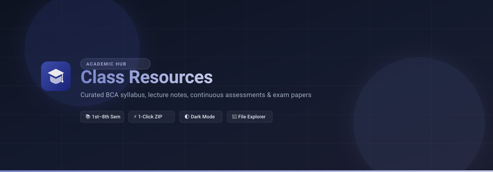

<p align="center">
  <picture>
    <source srcset="assets/header.png" type="image/png">
    
  </picture>
</p>

<h1 align="center">Class Resources</h1>

<p align="center">
  <strong>The centralized, open-access academic resource archive for Bachelor of Computer Applications (BCA).</strong>
  <br />
  Curated lecture notes, university syllabi, practical lab assignments, and previous year question papers.
</p>

<p align="center">
  <a href="https://shadowamitendu.github.io/ClassResources/"></a>
  <a href="https://github.com/ShadowAmitendu/ClassResources/tree/submissions"></a>
  <a href="#mandatory-attribution--terms"></a>
  <a href="https://amitendu.me"></a>
</p>

---

## 🌟 Overview

**Class Resources** is a lightweight, high-performance static web application built to eliminate the chaos of scattered PDF files, lost Telegram attachments, and broken Google Drive links across BCA semesters. 

Every semester is organized into a clean folder tree explorer powered by modern web standards, instant client-side ZIP packaging, and Material Design 2 aesthetics.

🔗 **Live Deployment:** [https://shadowamitendu.github.io/ClassResources/](https://shadowamitendu.github.io/ClassResources/)

---

## ✨ Features

- 📁 **File Explorer Tree View:** Interactive nested folders with real-time guide lines (`│`, `├──`, `└──`) inspired by modern code editors and desktop file explorers.
- 📦 **1-Click Bulk ZIP Downloads:** Download entire subjects or whole categories (Notes, Question Papers, Assignments) simultaneously via client-side [JSZip](https://stuk.github.io/jszip/) without server strain.
- 🌓 **Radial Dark Mode Transition:** Silky-smooth exponential bloom theme toggle matching the View Transitions API and CSS clip-path fallbacks.
- 📱 **Mobile Optimized:** Full-featured responsive layout with adaptive semester switcher dropdown, native touch targets, and sticky frosted-glass header/footer.
- ⚡ **Zero Backend Overhead:** Pure HTML5, CSS3, and Vanilla JavaScript hosted entirely on GitHub Pages with automated Python-driven JSON indexing.
- 🛡️ **Built-in Disclaimers & Empty State Banners:** Clear university syllabus notices (including 8th-semester syllabus advisories) and community submission banners.

---

## 🗂️ Semester Directory Structure

Resources are cataloged per semester across four standardized academic categories:

```text
ClassResources/
├── bca/
│   ├── data/                     # Generated JSON index files for each semester
│   │   ├── 1st.json
│   │   ├── 2nd.json
│   │   └── ... (up to 8th.json)
│   └── semesters/                # Raw source documents
│       ├── 1st/
│       ├── 2nd/
│       ├── ...
│       └── 7th/
│           ├── assignments/      # Lab exercises, project specs
│           ├── notes/            # Module-wise PDFs, class slides
│           ├── question-papers/  # University semester exam papers
│           └── syllabus/         # Official curriculum outlines
├── assets/                       # Banners, headers, icons
├── index.html                    # Main explorer interface
├── about.html                    # Project background & tech specs
├── changelog.html                # Version releases & historical timeline
├── terms.html                    # Academic fair use & attribution policy
├── style.css                     # Design system & tree guide lines
└── generate.py                   # Automated JSON metadata index generator
```

---

## 🚀 Local Development & Index Generation

To preview the project locally or index newly added resources:

1. **Clone the repository:**
   ```bash
   git clone https://github.com/ShadowAmitendu/ClassResources.git
   cd ClassResources
   ```

2. **Add or update PDF / document files:**
   Place files into their respective folders under `bca/semesters/<sem>/<category>/`.

3. **Re-generate the semester JSON indexes:**
   ```bash
   python generate.py
   ```
   *This automatically parses file sizes, nested directory trees, and updates `bca/data/*.json`.*

4. **Launch a local server:**
   ```bash
   # Python 3
   python -m http.server 8000
   ```
   Open `http://localhost:8000` in your web browser.

---

## 🤝 Submissions & Contributions

We actively welcome study notes, lab solutions, handwritten summaries, and past semester examination question papers from fellow students!

### How to Submit:
1. **Using GitHub Pull Requests:**
   - Switch to the dedicated [`submissions`](https://github.com/ShadowAmitendu/ClassResources/tree/submissions) branch:
     ```bash
     git checkout submissions
     ```
   - Add your files to the corresponding semester folder: `bca/semesters/<sem>/<category>/<subject>/`.
   - Run `python generate.py` to refresh the index.
   - Commit your changes and open a Pull Request against `submissions` or `master`.
2. **Without Git:**
   - Submit files via our [GitHub Issue Submission Portal](https://github.com/ShadowAmitendu/ClassResources/issues/new?template=resource-submission.yml) or email/reach out directly.

---

## 📜 Mandatory Attribution & Terms

All resources hosted in this repository are published exclusively for **non-commercial, educational, and reference purposes**.

> [!IMPORTANT]
> ### Author Tagging & Attribution Requirement
> If you mirror, fork, redistribute, publicly share, or utilize this project or its curated content on any platform (GitHub, personal websites, college portals, Telegram groups, social media):
> - **You MUST clearly tag and credit the original creator: Amitendu Bikash Dhusiya.**
> - **Include a direct link to the original repository:** `https://github.com/ShadowAmitendu/ClassResources`
> - **Include a link to the author portfolio:** [https://amitendu.me](https://amitendu.me)
>
> Removal of creator attribution, claiming sole authorship, or selling curated notes for monetary gain is strictly prohibited under our [Terms & Conditions](https://shadowamitendu.github.io/ClassResources/terms.html).

---

## 👨‍💻 Author & Maintainer

Curated and maintained with ❤️ by:

- **Amitendu Bikash Dhusiya**
- 🌐 **Portfolio:** [https://amitendu.me](https://amitendu.me)
- 🐙 **GitHub:** [@ShadowAmitendu](https://github.com/ShadowAmitendu)
- 💼 **LinkedIn:** [Amitendu Bikash Dhusiya](https://linkedin.com/in/amitendu)

---

<p align="center">
  <sub>Class Resources © 2026 • Hosted with GitHub Pages • Designed by Amitendu Bikash Dhusiya</sub>
</p>
